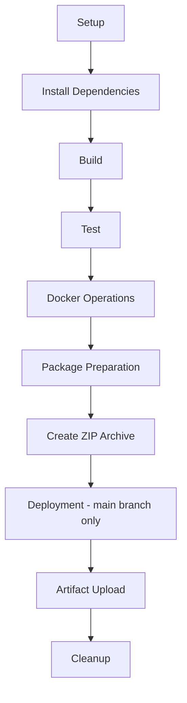

# dbk-saml-sso-features-toolkit Overview
We have developed a SAML Toolkit Simulator to test and validate the complete SAML Single Sign-On (SSO) flow, compatible with Candescent platform, in a local development environment. This Toolkit acts as a simulator to replicate the key functionalities of SAML Identity Provider, such as generating SAML assertions. Thus, it allows developers to verify during deployment, that their application’s SAML integration works as expected, and is compatible with the Candescent platform.
Components:
Frontend:
•   Displays homepage with ACS URL, Candescent public key, Attributes.
•   Allows downloading Candescent public key & click on Run Simulation button.
•   Shows success and error page according to response.
Backend:
•   Creates SAML assertion in XML format. 
•   Sign in via candescent private key. 
•   Encrypts the SAML assertion based on public certificate.

## client-web-app Overview

The `client-web-app` is a separate NestJS-based service that acts as the client-facing entry point for SAML SSO feature validation.  
It orchestrates calls to the SAML toolkit, validates tokens and metadata, and exposes simple APIs that downstream applications can use to test and integrate SAML SSO flows.

## Technologies Used

### Frontend (`sample-web-app/frontend`)
- **Framework**: React (Create React App)
- **Language**: TypeScript
- **State Management**: Redux Toolkit (`@reduxjs/toolkit`, `react-redux`)
- **Routing**: React Router (`react-router-dom`)
- **Styling**: CSS modules and standard CSS
- **Testing**: Jest, React Testing Library (`@testing-library/react`, `@testing-library/jest-dom`)

### Backend (`sample-web-app/backend`)
- **Framework**: NestJS (Node.js)
- **Language**: TypeScript
- **Build & Runtime**: Node.js + npm
- **Validation & Transformation**: `class-validator`, `class-transformer`
- **Security / Tokens**: `jsonwebtoken`, RSA key handling for signing ID Tokens
- **Testing**: Jest, Supertest

### client-web-app (`client-web-app`)
- **Framework**: NestJS (Node.js)
- **Language**: TypeScript
- **Configuration**: `@nestjs/config` for environment and configuration management
- **HTTP / Integration**: `@nestjs/axios` and `rxjs` for calling external SAML toolkit endpoints
- **Validation & Transformation**: `class-validator`, `class-transformer`
- **Security / Token Handling**: `jose` for working with JWTs and JWK/JWKS
- **Testing**: Jest and Supertest

## Clone the Project

Use the following steps to clone the repository locally:

```bash
git clone https://github.com/dfh-digital-insight/dbk-devex-saml-sso-toolkit.git
cd dbk-devex-saml-sso-toolkit-main
```

## Running the Sample Web App (Backend + Frontend)

The sample application contains both the backend (NestJS) and frontend (React).

### Prerequisites

- **Node.js**: Install a recent LTS version of Node.js.
- **npm**: Comes bundled with Node.js.

###  Start the Backend Server

Open a terminal and run:

```bash
cd sample-web-app/backend
npm install
npm run start:dev
```

This starts the NestJS backend server in watch mode. The default port is defined inside the backend application (commonly `http://localhost:9000` unless configured otherwise).

###  Start the Frontend Server

Open a new terminal window and run:

```bash
cd sample-web-app/frontend
npm install
npm start
```

The frontend React app will start on `http://localhost:8000` (as configured in the `start` script).

Once both servers are running:
- Access the **frontend** in your browser at `http://localhost:8000`.
- The frontend will communicate with the **backend** to generate client credentials, download metadata, and perform SAML-related operations.

## Application Flow

1. User opens the web application (e.g., `http://localhost:8000`).

2. Frontend displays session credentials and mock user attributes.

3. User provides:
   - ACS URL  
   - Vendor Encryption Certificate (Public Key)

4. User can download the **Candescent Public Key** for signature verification.

5. User clicks **Run Simulation**.

6. Frontend sends the input data to the backend IdP endpoint.

7. Backend:
   - Creates a SAML assertion
   - Signs it using Candescent’s private key
   - Encrypts it using the vendor’s public key
   - Base64-encodes the SAML response
   - Posts it to the vendor’s ACS URL

8. Frontend displays **Success** or **Error** based on the HTTP response.


## dbk-oidc-sso-features-toolkit Directories
 
```
dbk-oidc-sso-features-toolkit/
├── .github/
├── client-web-app/
├── dist/
├── documentation/
├── sample-web-app/
├── scripts/
```
 
---
 
## Directory Descriptions
 
### .github/
Contains CI/CD pipeline configurations and GitHub Actions workflows. This automates testing, building, and deployment processes.
 
### client-web-app/
The client-facing web application. It serves as the entry point for user requests and interactions with the system.
 
### dist/
Holds the final output of the entire project. This includes a ZIP archive(`saml-sso-feature-toolkit.zip`) that is delivered to clients for local deployment and execution.
- #### oidc-sso-feature-toolkit.zip
```
dbk-saml-sso-features-toolkit/
├── sample-web-app/
│   ├── frontend/
│   ├── backend/
│   ├── README.md
│   └── Dockerfile
│
├── client-web-app/
│
├── scripts/
│   ├── ps/
│   │   ├── init.ps1
│   │   ├── run-web-app.ps1
│   │   └── selftest.ps1
│   │
│   └── shell/
│       ├── init.sh
│       ├── run-web-app.sh
│       └── selftest.sh
│
├── documentation/
└── README.md
```
 
### documentation/
Contains all project-related documentation, excluding the main `README.md`. This may include architecture diagrams, API references, setup guides, and other technical documents.
 
### sample-web-app/
A complete web application that includes both frontend and backend modules. This serves as a reference implementation for the overall system.
 
### scripts/
Utility scripts to:
- Local Build in order to generate zip
- Create Docker images
- Containerize the application
- Run health checks on the deployed system
 
These scripts streamline local development and deployment workflows.
 
---
 
#### Pipeline Overview
 
