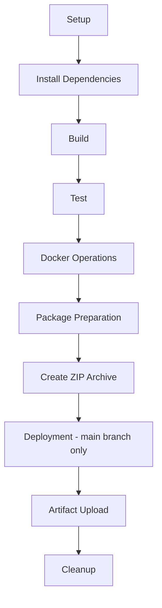

# dbk-saml-sso-features-toolkit Overview
We have developed a SAML Toolkit Simulator to test and validate the complete SAML Single Sign-On (SSO) flow, compatible with the Candescent production platform, in a local development environment. This toolkit acts as a simulator by replicating the key functionalities of SAML, such as generating SAML assertions. It allows developers to verify, during deployment, that their application’s SAML integration works as expected and is fully compatible with the Candescent production platform.
Components:
Frontend:
•   Displays a homepage containing the ACS URL, a non-editable vendor’s public certificate, and user attributes such as first name, last name, member ID, and email.
•    Provides an option to download the Candescent public key.
•    Includes a Run Simulation button that triggers the saml/login login API, which generates a SAML assertion that can be verified by the ACS endpoint.
•   Displays a Success page when a successful response is received from the ACS endpoint.
•   Displays an Error page with an appropriate error message when the ACS endpoint returns a failure response.
Backend:
•   Creates SAML assertion in XML format. 
•   Sign in via candescent private key. 
•   Encrypts the SAML assertion based on public certificate.

## client-web-app Overview

The `client-web-app` is a separate NestJS-based service that acts as the client-facing entry point for SAML SSO feature validation.  
It orchestrates calls to the SAML toolkit, validates tokens and metadata, and exposes simple APIs that downstream applications can use to test and integrate SAML SSO flows.

## Technologies Used

### Frontend (`sample-web-app/frontend`)
- **Framework**: React (Create React App)
- **State Management**: Redux Toolkit (`@reduxjs/toolkit`, `react-redux`)
- **Routing**: React Router (`react-router-dom`)
- **Styling**: CSS modules and standard CSS
- **Testing**: Jest, React Testing Library (`@testing-library/react`, `@testing-library/jest-dom`)

### Backend (`sample-web-app/backend`)
- **Framework**: NestJS (Node.js)
- **Build & Runtime**: Node.js + npm
- **Validation & Transformation**: `class-validator`, `class-transformer`
- **Security / Tokens**: `jsonwebtoken`, RSA key handling for signing ID Tokens
- **Testing**: Jest, Supertest

### client-web-app (`client-web-app`)
- **Framework**: NestJS (Node.js)
- **HTTP / Integration**: `@nestjs/axios` and `rxjs` for calling external SAML toolkit endpoints
- **Validation & Transformation**: `class-validator`, `class-transformer`
- **Security / Token Handling**: `jose` for working with JWTs and JWK/JWKS
- **Testing**: Jest and Supertest

## Clone the Project

Use the following steps to clone the repository locally:

```bash
git clone https://github.com/dfh-digital-insight/dbk-devex-saml-sso-toolkit.git
cd dbk-devex-saml-sso-toolkit-main
```

## Configuration

The sample web application includes a `config.json` file that allows you to configure the frontend and backend ports.

**Location:**  
`sample-web-app/config.json`

**Example:**
{
  "frontendPort": 8000,
  "backendPort": 9000
}

### Port descriptions:

- **frontendPort**: Port on which the sample frontend application runs
- **backendPort**: Port on which the backend server runs

Update these values as needed before starting the application.

## Running the Sample Web App (Backend + Frontend)

The sample application contains both the backend (NestJS) and frontend (React).

### Prerequisites

- **Node.js**: Install a recent LTS version of Node.js.
- **npm**: Comes bundled with Node.js.

###  Start the Backend Server

Open a terminal and run:

```bash
cd sample-web-app/backend
npm install
npm run start:dev
```

This starts the NestJS backend server in watch mode. The default port is defined inside the backend application (commonly `http://localhost:9000` unless configured otherwise).

###  Start the Frontend Server

Open a new terminal window and run:

```bash
cd sample-web-app/frontend
npm install
npm start
```

The frontend React app will start on `http://localhost:8000` (as configured in the `config.json`).

Once both servers are running:
- Access the **frontend** in your browser at `http://localhost:8000`.
- The frontend will communicate with the **backend** to generates a SAML assertion, signs it with Candescent’s private key, encrypts it using the vendor’s public key, Base64-encodes the resulting SAML response, and posts it to the vendor’s ACS URL.

## Application Flow

1. User opens the web application (e.g., `http://localhost:8000`).

2. Displays a homepage containing the ACS URL, a non-editable vendor’s public certificate, and user attributes such as first name, last name, member ID, and email.

3. User can download the **Candescent Public Key** for signature verification.

4. User clicks **Run Simulation** button that triggers the saml/login login API, which generates a SAML assertion that can be verified by the ACS endpoint

5. Backend:
   - Creates a SAML assertion
   - Signs it using Candescent’s private key
   - Encrypts it using the vendor’s public key
   - Base64-encodes the SAML response
   - Posts it to the vendor’s ACS URL

8. The system displays a Success page upon receiving a successful response from the ACS endpoint and an Error page with an appropriate message when a failure response is returned


## dbk-oidc-sso-features-toolkit Directories
 
```
dbk-oidc-sso-features-toolkit/
├── .github/
├── client-web-app/
├── documentation/
├── sample-web-app/
├── scripts/
└── README.md
```
 
---
 
## Directory Descriptions
 
### .github/
Contains CI/CD pipeline configurations and GitHub Actions workflows. This automates testing, building, and deployment processes.
 
### client-web-app/
The client-facing web application. It serves as the entry point for user requests and interactions with the system.
 
### dist/
Holds the final output of the entire project. This includes a ZIP archive(`saml-sso-feature-toolkit.zip`) that is delivered to clients for local deployment and execution.
- #### oidc-sso-feature-toolkit.zip
```
dbk-saml-sso-features-toolkit/
└── sample-web-app/
    ├── frontend/
    ├── backend/
    ├── Dockerfile
    ├── config.json
    └── scripts/
        ├── ps/
        │   ├── init.ps1
        │   ├── run-web-app.ps1
        │   └── selftest.ps1
        │
        └── shell/
            ├── init.sh
            ├── run-web-app.sh
            └── selftest.sh
```
 
### documentation/
Contains all project-related documentation, excluding the main `README.md`. This may include architecture diagrams, API references, setup guides, and other technical documents.
 
### sample-web-app/
A complete web application that includes both frontend and backend modules. This serves as a reference implementation for the overall system.
 
### scripts/
Utility scripts to:
- Local Build in order to generate zip
- Create Docker images
- Containerize the application
- Run health checks on the deployed system
 
These scripts streamline local development and deployment workflows.
 
---
 
#### Pipeline Overview
 
